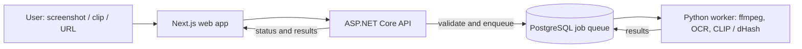

  

**B.Tech Computer Engineering (2026) &nbsp;·&nbsp; Jalgaon, Maharashtra, India**

---

## 👋 About me

I'm a Computer Engineering graduate focused on **Python, Django and backend development**. I learn by building software around real problems from my family's shop, college and community, not by copying tutorial projects.

**How I work:** understand the problem → design the data model → build and integrate → test → deploy.

I enjoy the backend most (databases, APIs, authentication, payments), plus the frontend needed to ship a complete product. I use AI tools (ChatGPT, Claude, DeepSeek) to explore approaches and debug. I write the requirements, review every change, run and test the app, and take responsibility for what gets deployed.

| | |
|---|---|
| 🚀 **Recently shipped** | [SceneSeek](https://github.com/Jayeshkalkate/SceneSeek): find a movie, series or anime from a screenshot or clip |
| 🔭 **Working on** | [LokSetu](https://github.com/Jayeshkalkate/loksetu): a civic complaint and citizen services platform |
| 🌱 **Learning** | C# and ASP.NET Core, Docker, CI/CD and cloud deployment |
| 💼 **Looking for** | A first role as a Python / Django / Backend (or junior Full-Stack / DevOps) developer |

---

## 🛠️ Tech stack

  

| Area | Technologies |
|---|---|
| **Languages** | Python, JavaScript, SQL, C# *(learning)* |
| **Backend** | Django, Django ORM, migrations, management commands, REST integrations, webhooks, ASP.NET Core *(fundamentals)* |
| **Data & caching** | PostgreSQL (Neon), SQLite, Redis (Upstash), schema design, query optimisation |
| **Auth & security** | Email OTP, role-based access control, rate limiting, CSRF protection, input validation, audit logging, Fernet encryption, HMAC verification |
| **Integrations** | Razorpay, Google Gemini, Telegram Bot API, TMDB, TVMaze, Jikan, AniList, Cloudinary, Brevo |
| **Frontend** | HTML5, CSS3, Bootstrap 5, JavaScript, Next.js, Progressive Web Apps |
| **DevOps & deployment** | Git, GitHub Actions, Docker, Linux, Render, Netlify, Gunicorn, WhiteNoise |
| **Exposure** | Jenkins, Ansible, Bash, AWS fundamentals, ReportLab, BeautifulSoup |

---

## ⭐ Featured projects

### 🎬 SceneSeek: find a title from a screenshot
Upload a screenshot, short clip or video link and SceneSeek tries to identify the movie, series or anime. A **C# / ASP.NET Core** API validates uploads and queues jobs, and a **Python worker** does frame extraction, OCR and matching against public metadata. Built as my hands-on project for learning .NET and a polyglot architecture.

`ASP.NET Core` `C#` `Python` `Next.js` `TypeScript` `PostgreSQL` `Docker` `GitHub Actions`

 

<b>🏗️ Architecture</b>

*Recognition is an ongoing area of development, and scenes without a readable title are harder to match.*

### 📒 KhataLink: a consent-based digital khata (udhaar) network
Shopkeepers and customers often rely on handwritten records, which makes balances and disputes hard to settle. KhataLink gives each shop its own scoped ledger while customers see dues across the shops they link. Entries are **voided or corrected, never deleted**, with audit logging and idempotency keys against double submits.

`Django` `PostgreSQL` `Redis` `ReportLab` `Cloudinary` `Gemini`

 

**Highlights:** tenant isolation in every query · OTP login with throttling · role-based access · PDF statements · AI-assisted bill extraction that the shop must review · automated test suite

### 🪑 Lavkush Furniture: a real store for a real business
In our family furniture shop, sharing photos and explaining prices one customer at a time took too long. I learned Python and Django to build a catalogue, which grew into a full store with cart, wishlist, returns, coupons and a business dashboard.

`Django` `PostgreSQL` `Razorpay` `Docker` `GitHub Actions`

 

**Highlights:** server-side Razorpay orders · signature-verified callbacks and HMAC webhooks · row-locked inventory · automatic refund if stock runs out after payment · validated bulk CSV/XLSX import · SEO-friendly product URLs and sitemap

---

## 📁 More projects

| Project | What it does | Stack | Links |
|---|---|---|---|
| **🤖 Ask Me** | Secure AI document assistant: extract fields from ID documents with Gemini and chat over your own files. Installable PWA that works offline | Django · Gemini · OCR · PWA · Fernet | [Live](https://ask-me-smart-document-assistant.onrender.com) · [Code](https://github.com/Jayeshkalkate/ask_me) |
| **🎞️ MoviesHub** | Movie, series and anime discovery with Gemini-assisted search, cinematic universes and a Telegram bot | Django · Redis · Gemini · TMDB · Telegram | [Live](https://movies-hub-6dhp.onrender.com) · [Code](https://github.com/Jayeshkalkate/Movies-Hub) |
| **🖥️ Matoshree** | Common Service Centre portal: applications, document verification, appointments (no double booking) and PDF receipts | Django · PostgreSQL · Razorpay · BeautifulSoup | [Live](https://matoshree-cyber.onrender.com) · [Code](https://github.com/Jayeshkalkate/Matoshree-Cyber) |
| **🏛️ LokSetu** *(in development)* | Civic complaint platform with evidence uploads, tracking IDs, department routing and role-scoped dashboards | Django · PostgreSQL · GitHub Actions | [Live](https://lok-setu.onrender.com) · [Code](https://github.com/Jayeshkalkate/loksetu) |
| **🚗 VIndia** | Vehicles of India: 350+ models, 42+ brands, live search, cascading filters and side-by-side comparison | HTML · CSS · Bootstrap · JavaScript | [Live](https://vehicles-of-india-vindia.netlify.app/) · [Code](https://github.com/Jayeshkalkate/VIndia) |

<b>📖 The story behind each project</b>

 

**Ask Me:** College constantly asks for student IDs and registration numbers, and finding the right document photo each time is a hassle. Ask Me stores documents, extracts fields with Gemini, lets users review and edit them, and answers questions grounded only in their own data. Data is encrypted at rest, and the PWA works offline.

**MoviesHub:** Recommendations in our friends' Telegram group were scattered across messages and websites. MoviesHub combines TMDB, TVMaze, Jikan and AniList metadata, groups related titles into cinematic universes, and connects to a Telegram bot via webhooks. Redis caching limits repeated API calls. *AWS S3 storage is integrated but currently disabled in the live deployment.*

**Matoshree:** Applying for something like an income certificate means finding documents, visiting a centre and chasing status updates. Matoshree puts services, required documents, applications, appointments, tracking and receipts in one portal, with owner and admin dashboards.

**LokSetu:** Citizens in smaller towns can find it hard to file a complaint with the right department and follow it up. LokSetu implements complaint submission, evidence uploads, routing, login throttling and file validation. The wider transparency vision needs verified official data and is not yet implemented.

**VIndia:** My first website, built in third year after I struggled to compare vehicles in one place. I learned HTML, CSS and JavaScript by organising the data in JSON and building filters and comparison around it.

---

## 🧰 How I build

- **Security first:** CSRF protection, throttled logins and OTPs, validated uploads, authenticated file access, audit logs
- **Data integrity:** database constraints, row locking, idempotency keys, append-only records where history matters
- **Tested:** automated test suites in KhataLink, LokSetu, SceneSeek and Lavkush Furniture
- **Shipped:** CI with GitHub Actions, Docker, health checks, and free-tier hosting on Render, Neon, Cloudinary and Netlify
- **Documented:** setup guides, `.env.example` files and deployment notes in every project

---

## 💼 Experience

| Role | Period | What I did |
|---|---|---|
| **Python Programming Intern**, Prasunet *(Remote)* | Mar 2025 – Apr 2025 | Python scripting, file handling, functions and modular programming |
| **Full Stack Developer Intern**, Vaishnav Technologies *(Remote)* | Feb 2025 – Mar 2025 | Django, HTML, CSS, JavaScript and Bootstrap web apps; Cloudinary media; Render deployment with Git and GitHub |
| **Data Entry Intern**, Rural Field Survey Program | May 2022 – Jun 2022 | Survey data collection, validation and organisation in Excel |

## 🎓 Education

**B.Tech in Computer Engineering**, Godavari College of Engineering, Jalgaon (DBATU) · 2022 – 2026 · CGPA 7.2 / 10

## 📜 Certifications & training

- **Red Hat:** System Administration I (RH124) · Linux Fundamentals (RH104) · Introduction to OpenShift Applications (DO101)
- **Simplilearn SkillUp:** Python 3.x · SQL for Data Analysis · Web Scraping with BeautifulSoup
- **NSDC / Skill India:** Web Design and Development
- **IIT Bombay Spoken Tutorial:** Python and Java
- **DevOps Bootcamp:** Jenkins, Docker, Linux, AWS, Ansible, Bash scripting
- **Other:** Smart India Hackathon 2024 · six-day Python programming workshop

[📂 View all certificates](https://drive.google.com/drive/folders/1Iwxvmfb4jzhRlW1Vq3ToGJekdggKDhWM?usp=drive_link)

---

## 📊 GitHub stats

---

### 🤝 Let's connect

I'm looking for a **Python / Django / Backend Developer** role (junior Full-Stack and DevOps roles too) where I can contribute to real products and learn from an experienced team.

*Building practical solutions, one problem at a time.*

